# NH4X Volca Drum Suite

A free **step sequencer** and **editor panel** for the **Korg volca drum** inside REAPER, plus a few helper actions. Two JSFX plugins, no extra software.

By NH4X. Panel 2.0 · Sequencer 1.0. Music: https://nh4x.bandcamp.com/

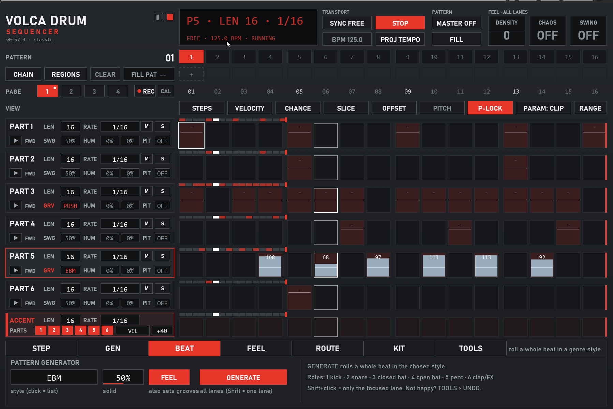

## Install (5 minutes, do it once)

> [!IMPORTANT]
> Do the steps in this order. Most "it doesn't work" problems come from step 5 (MIDI out, routing, FX order) or step 6 (volca channels).

Click any screenshot to see it full size.

### Step 1 · Install ReaPack
ReaPack is the free package manager for REAPER. Already have it? Go to step 2.

1. Go to https://reapack.com/ and download ReaPack for your system (Windows: `reaper_reapack-x64.dll`).
2. Find the downloaded file in your **Downloads** folder and **copy** it.
3. In REAPER: **Options > Show REAPER resource path in explorer/finder**. A file window opens.
4. Open the folder **UserPlugins** in there (if it's missing, create it) and **paste** the file.
5. **Close REAPER and start it again.** ReaPack opens its *Manage repositories* window once: that means it works.

<p align="center">
  <a href="install/1-reapack-download.png">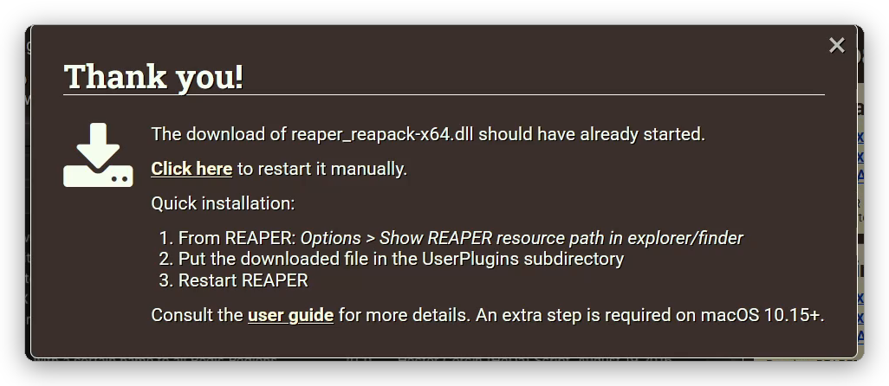</a>
  <a href="install/1-resource-path.png">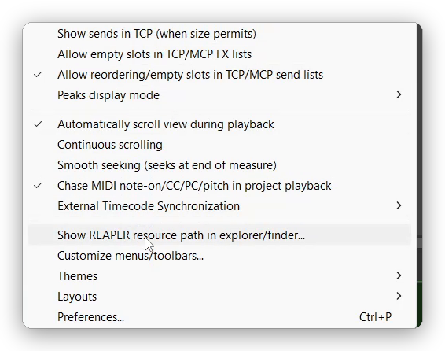</a>
  <br><sub>Download ReaPack · Options > Show REAPER resource path</sub>
</p>
<p align="center">
  <a href="install/1-userplugins.png">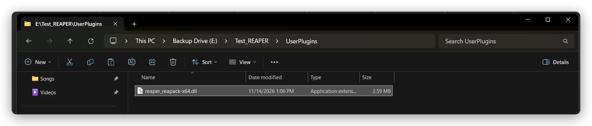</a>
  <br><sub>The dll in <code>UserPlugins</code></sub>
</p>

### Step 2 · Add this repository
1. In REAPER: **Extensions > ReaPack > Import repositories...** (or, in the *Manage repositories* window: **Import/export... > Import repositories...**).
2. Paste this line and click **OK**:

```
https://github.com/NH4Xnet/volca-drum-suite/raw/main/index.xml
```

<p align="center">
  <a href="install/2-import-repository.png">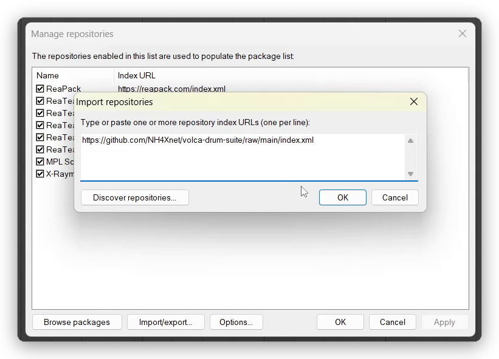</a>
</p>

### Step 3 · Install the two plugins
1. **Extensions > ReaPack > Browse packages**.
2. Type **volca** into the filter.
3. Right-click **Volca Drum Sequencer** > **Install**, then right-click **Volca Drum Panel** > **Install**.
4. Confirm with **Apply** (or **OK**).

This also installs the helper actions (they all start with "Volca" in the action list).

<p align="center">
  <a href="install/3-browse-packages.png">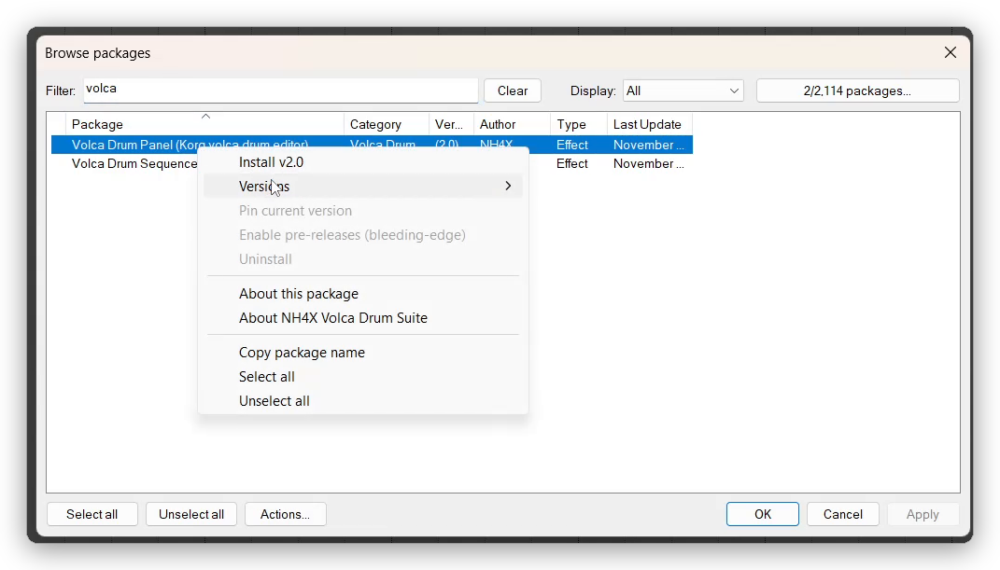 Install"></a>
</p>

### Step 4 · Start the listener (once)
The panel and the sequencer need a small background helper to talk to each other (it also saves sound files and reads your regions).

1. **Actions > Show action list**.
2. Search for **volca listener**.
3. Select **Script: Volca listener (start).lua** and click **Run** (or double-click it).
4. A window asks if it may start with REAPER from now on: click **Yes**.
5. A message confirms it. From now on it starts with REAPER by itself. (If you click No, it runs until you close REAPER and asks again next time.)

<p align="center">
  <a href="install/4-listener.png">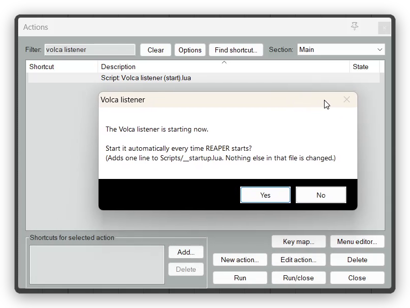</a>
</p>

### Step 5 · Set up the track
1. **Add a track** (**Track > Insert new track**).
2. **Enable MIDI out to your volca**: **Options > Preferences > Audio > MIDI Outputs**, right-click the port your volca is plugged into > **Enable output**. The **Enable** column shows a dot for that port.
   The **Clock** column must stay **empty**: REAPER must not send MIDI clock to the volca, or the volca's own sequencer starts playing along. (If it shows a dot, right-click the port and switch the clock off.) Click **OK**.
3. **Open the track's routing window** (the track's **Route** button).
4. Under **MIDI Hardware Output** pick your volca's MIDI port and **Send to original channels**. (Not a single channel: the parts listen on channels 1-6.) Close the window.

<p align="center">
  <a href="install/5-midi-output.png">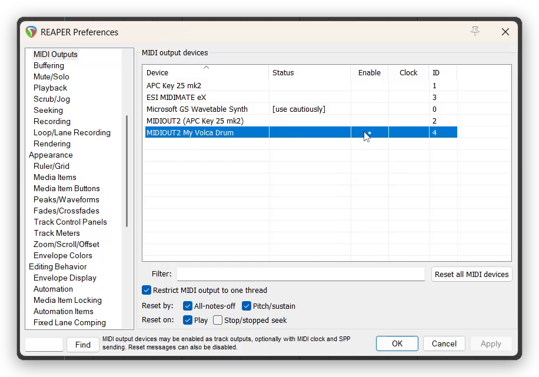 MIDI Outputs: volca port enabled, Clock column empty"></a>
  <a href="install/5-route.png">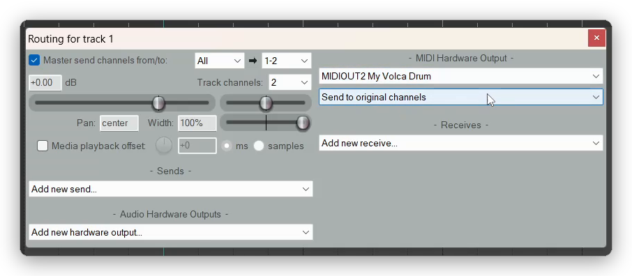</a>
  <br><sub>MIDI output enabled, no clock · Routing: MIDI Hardware Output</sub>
</p>

5. Click the track's **FX** button and type **volca** into the filter.
6. Add **first the Volca Drum Sequencer**, **then the Volca Drum Panel**. The order matters.
7. **Arm the track** (its record button). Then the sequencer also runs smoothly while REAPER is stopped (FREE mode) and hears your MIDI keyboard for tap record.

<p align="center">
  <a href="install/5-add-fx.png">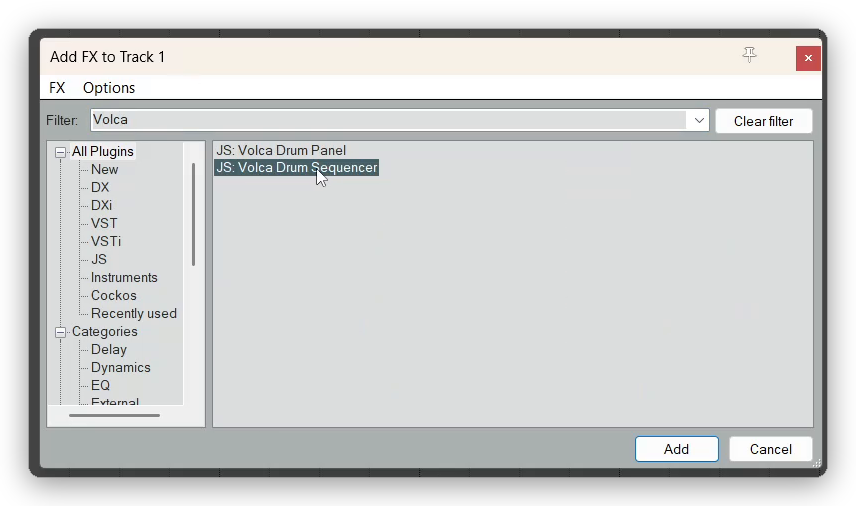</a>
  <a href="install/6-done.png">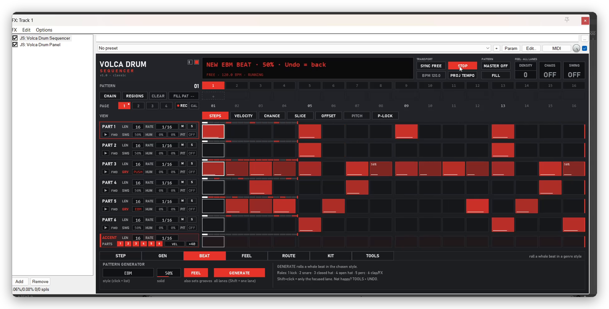</a>
  <br><sub>Sequencer first, then panel · Done</sub>
</p>

**You are done.** To hear the volca through REAPER (if its audio comes back through your audio interface): add a second track, set its input to the volca's input, arm it and turn record monitoring on. Otherwise you hear it from its own output or your mixer.

### Step 6 · Set up the volca
- **Split channel mode**, so part 1-6 listen on MIDI channel 1-6 (the Korg manual shows how).
- Recommended: the custom firmware **vdcf 1.22** by hj-oja: https://github.com/hj-oja/vdcf
  It adds FILT and CLIP (the purple rows in the panel) and makes velocity work like this: 63 = the panel's LEVEL, lower = ghost note, higher = accent. On the stock firmware everything else works.

### Check it works
1. In the panel, press **SEND ALL**. Then press the **play button** in a part header: the volca plays one hit.
2. In the sequencer, click a few steps in lane 1 and press play in REAPER: you hear the pattern.
3. In the panel, click a part title, then **SOUND > SAVE PART**: the display shows the saved name. (If it says *RUN ACTION 'VOLCA LISTENER (START)'*, do step 4.)

## What's in it

| What | Where | What it does |
|---|---|---|
| **Volca Drum Sequencer** | FX browser: JS | 6 lanes × 64 steps for the 6 volca parts. See below. |
| **Volca Drum Panel** | FX browser: JS | Every parameter of all 6 parts + waveguide on one screen, kits, sounds, randomize, morph. See below. |
| Volca listener (start) | Action list | Background helper: sound save / rename / delete, regions = patterns. Step 4. |
| Volca kit (save) / (kit +) / (kit -) / (send all) | Action list | Save the panel as a new kit, next / previous kit, send the whole kit. For keys or a MIDI controller. |
| Volca sound (save) / (load) | Action list | Save / load the focused part as a sound file. For keys or a MIDI controller (the panel's SOUND menu does the same). |
| Volca duck to selected tracks | Action list | Lets the sequencer duck other tracks (sidechain style). See **Duck trigger**. |

## The sequencer

| Feature | What it does |
|---|---|
| **Steps** | Click = on, click again = off, drag = paint / erase. Velocity, slice (ratchets), condition, offset and ramp per step (view tabs and right-click menu). |
| **Lanes** | Each lane has its own length and rate (polymeter), direction, swing, humanize, pitch, mute / solo. |
| **Conditions** | Chance, A:B loops, 1ST, FILL, PRE, NEI (like the vdcf firmware's own sequencer). **FILL** switch + **AUTO FILL** every n bars. |
| **P-locks** | Per step, any panel parameter (P-LOCK tab, PARAM button). The value comes back after the hit. Trigless steps = locks only, no note. |
| **Patterns** | 16 patterns, chain, fill pattern. **Regions = patterns**: name regions "P1 …", "P2 …" and the song switches patterns by itself (needs the listener). |
| **Kit per pattern** | Each pattern can switch the panel to a saved kit. |
| **Feel** | Global swing, CHAOS (one knob that loosens everything), DENSITY (thin out / fill up), EVOLVE (small changes every n bars). |
| **Beat generator** | GEN styles fill the lanes with a starting groove: 24 styles from old EBM, futurepop and rhythm noise to house, breakbeat, DnB, trap, funk, bossa nova and swing. |
| **Sync** | SYNC REAPER = locked to the project (loops, jumps, render). FREE = own play button and tempo. |
| **Tap record** | Play the parts on MIDI channel 1-6 and the hits land on the nearest step. |

Rest the mouse for a second on a control and the readout says what it does. **Ctrl+C / V / A / Z stay with REAPER**, so copy / paste / undo live in the right-click menus. Pattern data is saved with the project; REAPER presets of the sequencer = whole sequencer states.

### Duck trigger
The DUCK row picks lanes that also send a trigger (C1 on MIDI channel 10). Select the tracks that should duck (bass, pads …) and run **Volca duck to selected tracks**: it adds a MIDI receive from the sequencer track (channel 10 > bus 2). Run it again on a track = receive removed. On the ducking track you need a plugin that ducks on MIDI notes, e.g. ShaperBox 3 (VST3): set its MIDI input to Bus 2 and turn on *Map REAPER MIDI buses to VST3 MIDI buses* in its pin menu.

## The panel


| Action | How |
|---|---|
| Change a value | Drag or mouse wheel on the bar |
| Default value | Double-click the bar |
| Exact value | Hover the bar, type 0-127, Enter |
| Select (SRC / MOD.T / EG.T) | Click a segment, drag, or mouse wheel. Each row changes only its own part of the Select CC (combination n = value × 45 / 128) |
| Select a part | Click its title (PART 01 … WAVEGUIDE) |
| Copy / paste a part, sound files | **SOUND** button, or right-click a part title |
| Save / load a kit | REAPER's preset menu at the top of the FX window, or the **Volca kit** actions |
| Send everything | **SEND ALL**. **AUTO SEND** (on by default) does it once after a project load |
| Randomize | Pick target and amount in RANDOM, press **ROLL**. **UNDO** takes back the last roll, paste, kit load or morph (press again = redo) |
| Lock a cell / row / part | Right-click the bar / click the row name (right-click = all parts) / Shift+click the part title |
| Morph | **SET A**, change or load a kit, **SET B**, then move the MORPH bar |
| Test hit / pitch quantize | Play button / **Q** in the part header |
| Link layers | **LINK**: a change on one layer goes to the other layer too (also for sequencer p-locks) |
| Look / color | Small square (look) and color swatch (click or wheel) at the top left. Same in the sequencer |

Locks and morph snapshots are saved with the project, not in presets. Sound files live in REAPER's resource folder under `Data/NH4X Volca/VolcaSounds` and are shared by all projects.

**Without the sequencer:** notes 65 / 67 / 69 / 71 / 72 / 74 on any channel play part 1-6, so one piano roll plays all parts. Notes on channel 11-16 go to part 1-6 unchanged, to play a part melodically (best with **Q** on).

## Good to know
- The volca has no MIDI out, so the panel only knows what it sent. If the volca was switched on late, press **SEND ALL**.
- The panel sends at most 8 CCs per audio block, so a full kit dump doesn't choke the MIDI line.
- Pitch quantize (QPI) is CC 53, found in the Synthmata volca drum editor.
- The Sleeve look uses the free font **Big Shoulders Display** (Google Fonts) if it's installed; otherwise Bahnschrift Condensed.
- For MIDI controllers: every control is a plugin parameter. Panel: Roll (slider 146) and Undo (147) act as buttons (send 1), Morph = slider 148.
- Made and tested on Windows. macOS should work, but fonts will look different (not tested).

### Known limits
- **One sequencer + panel pair per REAPER session works best.** They talk through shared memory that is global in REAPER: a panel in another open project tab also counts as "found".
- The panel uses **CC 119 on MIDI channel 16** to talk to the sequencer and doesn't pass it on.
- With a REAPER **loop**, a kit change at the loop start arrives a little late on the first hit after the wrap.

## Other DAWs
The **panel** should work in other DAWs through **ysfx** (free, loads JSFX as VST3 / AU / CLAP): https://github.com/JoepVanlier/ysfx/releases. Not tested by me. The **sequencer** and the actions need REAPER.

## Changes
- **Suite 1.0** (panel 2.0, sequencer 1.0): first release of the sequencer and the helper actions. Repository renamed from volca-drum-panel. Panel: AUTO SEND on project load, sound files (save / load / rename / delete), kit actions and kit names, works with the sequencer (p-locks, kit per pattern, LINK for locks), undo for kit load and morph, fixes.
- Panel 1.5.2: Fix: switching Q off always brings the part back to its PITCH value.
- Panel 1.5.1: Classic look: part titles fit at any window size.
- Panel 1.5: Select split into SRC / MOD.T / EG.T rows. Two looks + 14 color themes, test hit and Q (QPI) per part, tooltips, notes on channel 11-16 play parts melodically. Install via ReaPack.
- Panel 1.0.1: Select is easier to set with the mouse.
- Panel 1.0: first release.

## License
Free to use and change. If you share a changed version, please credit the original.
