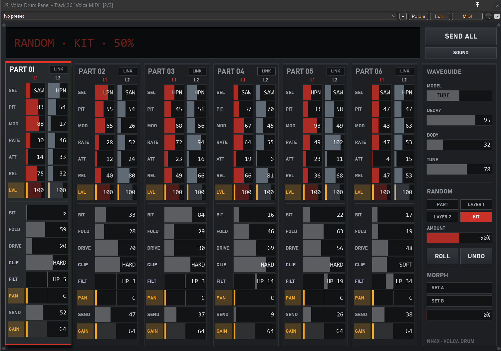
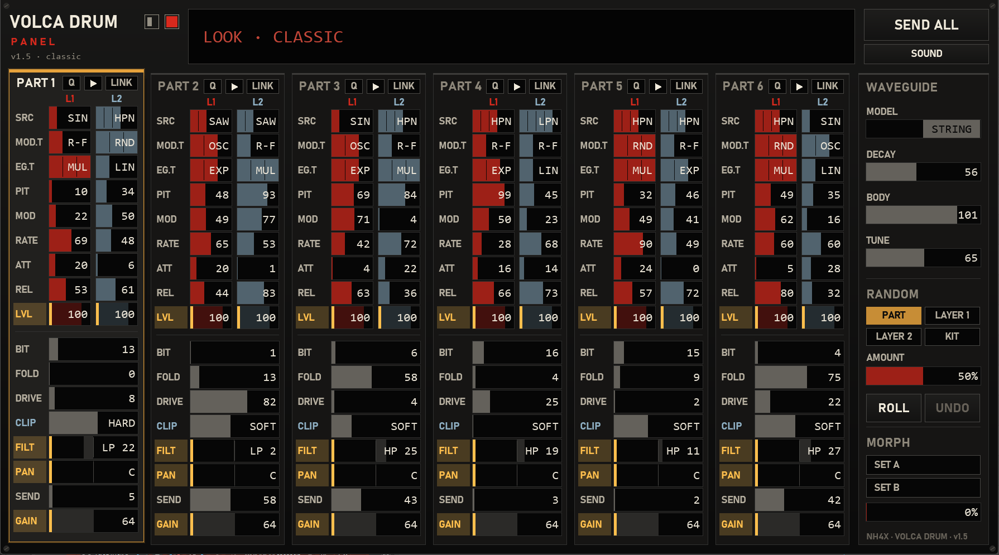
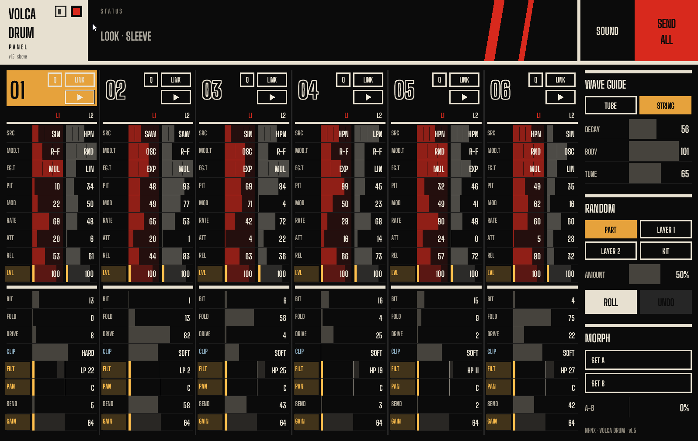

# Volca Drum Panel

A free editor for the **Korg volca drum** inside REAPER, as one JSFX file. All parameters of all 6 parts and the waveguide on one screen, with a big readout that shows what you just changed in plain words (e.g. `SAW · OSCILLATE · EXP` instead of a raw number).

By NH4X. Version 1.5. Music: https://nh4x.bandcamp.com/

**New here? Go straight to [Setup](#setup-do-this-once-5-minutes). It takes 5 minutes, and step 2 is the one people miss.**

## What it does
- **Every parameter on one screen:** 6 parts (both layers + mix) and the waveguide. Drag, mouse wheel, double-click for default, or hover and type a number.
- **Select split into three rows:** SRC (source), MOD.T (modulation type) and EG.T (envelope type). Change one without scrolling through all 45 combinations.
- **Readable values:** pan, filter, clip and model show what they mean; the readout shows the full Select combination by name.
- **Test hit** button per part, **Q** button per part = pitch quantize (QPI, CC 53).
- **Two looks** (Classic / Sleeve) and **14 color themes**. Rest the mouse on a button for a second and the display says what it does.
- **Kits** = REAPER presets of the plugin. Loading one sends the changes to the volca. **SEND ALL** pushes the whole kit.
- **Link L1+L2** per part: a change on one layer goes to the other layer too.
- **Copy / paste** a part, also into another kit.
- **Randomize** part, layer or the whole kit, with an amount and drum-friendly ranges (short attacks, filter never fully closed). **Undo / redo**.
- **Locks:** lock single cells, rows or whole parts so randomize leaves them alone.
- **Morph A > B:** take two snapshots, then blend between them with one control.
- **One piano roll for all 6 parts:** notes 65 / 67 / 69 / 71 / 72 / 74 on any channel are sent to part 1-6. Notes on channel 11-16 go to part 1-6 unchanged, to play a part melodically (best with **Q** on).
- Everything is a plugin parameter: automation and MIDI controllers work.

## What you need
- REAPER (made on Windows; on macOS it should work, but the fonts will look different, not tested).
- A Korg volca drum connected to your computer by MIDI (a MIDI interface or a USB-MIDI cable).
- The volca set to **split channel mode**, so part 1-6 listen on MIDI channel 1-6. The Korg manual shows how.
- **FILT and CLIP** (purple row names) need the custom firmware **vdcf** by hj-oja (https://github.com/hj-oja/vdcf). On the stock Korg firmware these two do nothing; everything else works.

## Setup: do this once (5 minutes)

> [!IMPORTANT]
> Most "it doesn't work" problems come from step 2 or step 4. If the volca stays silent, check those two first.

**1. Install the panel**
*With ReaPack (recommended, you get updates automatically):* **Extensions > ReaPack > Import repositories...**, paste
`https://github.com/NH4Xnet/volca-drum-panel/raw/main/index.xml`
and click OK. Then **Extensions > ReaPack > Browse packages**, search for "Volca Drum Panel", right-click it, **Install**, **Apply**.
*By hand:* go to **Options > Show REAPER resource path in explorer/finder**, open the `Effects` folder and drop `Volca Drum Panel.jsfx` in there.

**2. Let REAPER talk to your volca**
REAPER ignores MIDI ports until you switch them on.
Open **Options > Preferences** (Ctrl+P) and go to **Audio > MIDI Outputs**. Find the port your volca is plugged into (your MIDI interface or USB cable), right-click it and choose **Enable output**. Click OK.

**3. Put the panel on a track**
Make a new track, click its **FX** button and add **JS: Volca Drum Panel**. The panel opens.

**4. Send the track to the volca**
Click the track's **Route** button. Under **MIDI Hardware Output**, pick your volca's port and leave it on **Send to original channels**.
Don't pick a single channel there: the panel talks to part 1-6 on channels 1-6, and with one fixed channel only one part would listen.

**5. Sync once**
Press **SEND ALL** on the panel. Now the volca sounds exactly like what you see. Turn a control and you should hear it change right away.

**Playing it:** draw notes in a MIDI item on the same track (notes 65 / 67 / 69 / 71 / 72 / 74 = part 1-6). To play live from a keyboard, also arm the track and switch on input monitoring.

## How to use

| Action | How |
|---|---|
| Change a value | Drag or mouse wheel on the bar |
| Default value | Double-click the bar |
| Exact value | Hover the bar, type 0-127, Enter |
| Select (SRC / MOD.T / EG.T) | Click a segment, drag, or mouse wheel (one option per notch). Each row changes only its own part |
| Select a part | Click its title (PART 01 ... WAVEGUIDE) |
| Copy / paste a part | **SOUND** button, or right-click a part title |
| Save / load a kit | REAPER's preset menu at the top of the FX window |
| Randomize | Pick target and amount in RANDOM, press **ROLL**. **UNDO** takes back the last roll or paste (press again = redo) |
| Lock a cell | Right-click (or Shift+click) the bar |
| Lock a row | Click the row name (this part) / right-click it (all parts) |
| Lock a part | Shift+click its title |
| Morph | **SET A**, change or load a kit, **SET B**, then move the MORPH bar |
| Test hit / pitch quantize | Play button / **Q** in the part header |
| Look / color | Small square (look) and color swatch (click or wheel) at the top left |

Locks and morph snapshots are saved with the project, not in presets.

## Good to know
- The volca has no MIDI out, so the panel only knows what it sent. If the volca was switched on late, press **SEND ALL**.
- Nothing is sent when a project loads (no surprise changes).
- The panel sends at most 8 CCs per audio block so a full kit dump doesn't choke the MIDI line.
- Pitch quantize (QPI) is CC 53, found in the Synthmata volca drum editor.
- The Sleeve look uses the free font **Big Shoulders Display** (Google Fonts) if it's installed; otherwise Bahnschrift Condensed.
- For MIDI controllers: Roll (slider 146) and Undo (147) act as buttons (send 1), Morph = slider 148.

## Coming with the Volca Drum Sequencer
A step sequencer for the volca drum is on its way, in this same ReaPack repository. With it, more parts of the panel come alive: sound files (save / load / rename / delete a part from the SOUND menu), kit scripts (save, next, previous, kit names in the display and in MORPH), a kit per sequencer pattern, p-locks, and **Q** following the sequencer's pitch lanes. Until then these parts simply stay quiet.

## Changes
- 1.5: Select split into SRC / MOD.T / EG.T rows. Two looks + 14 color themes, test hit and Q (QPI) per part, tooltips, notes on channel 11-16 play parts melodically, FILT locked for ROLL by default. Install via ReaPack.
- 1.0.1: Select (SEL) is easier to set with the mouse: slow relative drag, wheel = one combination per notch.
- 1.0: first release.

## License
Free to use and change. If you share a changed version, please credit the original.
